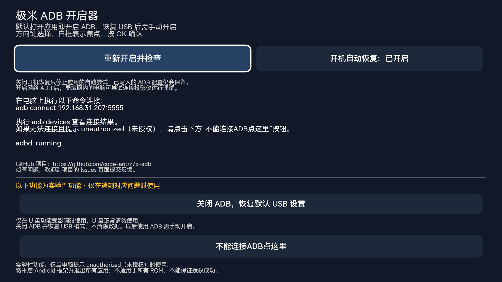

# 极米 ADB 开启器

> [!IMPORTANT]
> **只想开启 ADB？下载 APK，安装到投影仪后打开即可。无需阅读实验过程，也无需安装 Activity Launcher。**
>
> [下载最新版 APK](https://github.com/code-ant/z7x-adb/releases/latest/download/Z7X-ADB.apk) · [最新 Release](https://github.com/code-ant/z7x-adb/releases/latest)
>
> 电脑与投影仪连接同一局域网，按照应用显示的实际 IP 执行 `adb connect IP:5555`，再执行 `adb devices` 检查状态。若此前使用过“关闭 ADB，恢复默认 USB 设置”，需要手动点击“重新开启并检查”。

本项目是原生 Java Android 工程，提供网络 ADB 开启、状态检查和 TV 遥控器操作。普通开启流程已在极米 Z7X 高亮版 Android 9 上验证；名称改为“极米 ADB 开启器”不代表支持全部极米机型。

## 下载与使用

- [最新版 APK 直接下载（固定链接）](https://github.com/code-ant/z7x-adb/releases/latest/download/Z7X-ADB.apk)
- [v1.2.0 APK](https://github.com/code-ant/z7x-adb/releases/download/v1.2.0/Z7X-ADB-v1.2.0.apk)
- [全部版本及更新日志](https://github.com/code-ant/z7x-adb/releases)

1. 将 APK 复制到 U 盘，在投影仪文件管理器中安装并打开。
2. 应用默认自动开启 ADB，显示连接命令和 `adbd` 状态。
3. 电脑安装 [Android Platform-Tools](https://developer.android.com/tools/releases/platform-tools)，执行应用显示的命令：

   ```sh
   adb connect 投影仪实际IP:5555
   adb devices
   adb shell id
   ```

设备列表为 `device` 且能执行 shell，才表示连接和授权成功。`adbd: running` 仅表示服务运行，不能保证电脑已经获得授权。

## 设备兼容性反馈

| 设备 | 状态 |
| --- | --- |
| **极米 Z7X 高亮版** | ✅ 可用 |
| **极米 H3S** | ✅ 可用 |
| **极米 Z9X** | ✅ 可用 |
| **极米 M1** | ✅ 可用 |
| **极米 Z6/Z6X/Z6X Pro** | ✅ 可用 |
| **极米 Z8X** | ✅ 可用 |
| **极米 H3** | ⏳ 未验证 |
| **极米 H2S** | ⏳ 未验证 |
| **极米 Z4X** | ⏳ 未验证 |

## 页面功能

方向键选择按钮，白色边框和放大表示焦点，遥控器 **OK** 执行。需要精准点击其他应用界面时，可连接蓝牙鼠标。

| 功能 | 说明 |
| --- | --- |
| 重新开启并检查 | 手动开启 ADB，显示实际 IP 的连接命令及服务状态 |
| 开机自动恢复 | 控制本应用是否在开机后尝试开启；关闭此选项不等于关闭 ADB |
| 关闭 ADB，恢复默认 USB 设置（实验性） | 仅在 U 盘功能受影响时使用；关闭 ADB 并尝试恢复已识别固件的 USB 模式，同时关闭自动开启。不会清空个人数据，U 盘正常请勿使用 |
| 不能连接ADB点这里（实验性） | 仅在电脑提示 `unauthorized` 时尝试，确认后请求重启 Android 框架；所有应用会退出，不保证所有 ROM 都能自动授权 |

实验功能与普通功能由分割线和醒目标识区分。当前关闭功能只在识别到特定固件 USB 脚本后执行，不是通用的恢复出厂功能。



## 全部版本功能说明

| 版本 | 功能与变化 | 更新日志 |
| --- | --- | --- |
| **v1.2.0** | 更名为极米 ADB 开启器；显示实际 IP 的连接指引；简化为 adbd 状态；新增实验性框架重启和关闭 ADB／恢复 USB 模式，其中框架重启授权方案参考 [Lpaipai/xgimi-adb-guide](https://github.com/Lpaipai/xgimi-adb-guide) 实现；关闭后改为手动开启；添加 GitHub／Issues 入口与实验区域标识；拆分实验文档 | [v1.2.0](https://github.com/code-ant/z7x-adb/releases/tag/v1.2.0) |
| **v1.1.0** | 增加 TV 遥控器方向键、白框放大焦点和 OK 操作；开机恢复按钮；执行过程中保留焦点；保留打开即自动开启 | [v1.1.0](https://github.com/code-ant/z7x-adb/releases/tag/v1.1.0) |
| **v1.0.0** | 初始版本：自动设置网络 ADB 配置、启动服务、属性读回及本机端口检查、手动重试和开机恢复选项；提供 Android 源码 | [v1.0.0](https://github.com/code-ant/z7x-adb/releases/tag/v1.0.0) |

## 实验过程与原理

- [完整手动开启过程、Factory Menu 截图与历史验证记录](docs/experiments.md)
- [v1.2.0 实验功能原理、执行步骤与验证边界](docs/experimental-features.md)
- [v1.1.0 遥控器验证记录](docs/release-v1.1.0.md)

## 适用范围与反馈

已验证设备为极米 Z7X 高亮版、Android 9 / API 28，当前 `ro.adb.secure=0`、SELinux 为固件原有的 Permissive。应用不会修改这两项设置。其他型号、固件以及整机冷启动后的恢复尚不能保证；NEW Z6X 的自动授权流程仅作为实验参考，未由本项目在对应设备上验证。

v1.2.0 已验证安装、启动、普通 ADB 连接、页面与遥控器操作；关闭 ADB 后 U 盘识别和实验性框架重启后的授权尚未完成实机闭环验证。网络 ADB 请在可信局域网使用。

遇到问题请 [提交 Issues](https://github.com/code-ant/z7x-adb/issues)，附上型号、固件版本、应用版本与错误提示，不要上传密钥或账号信息。卸载 APK 不会自动撤销已经写入的 ADB 配置。

## 源码与构建

使用 Android Studio 打开仓库根目录，或配置 `ANDROID_HOME` 后运行：

```sh
./gradlew assembleRelease
```

Windows 使用 `gradlew.bat assembleRelease`。工程使用 AGP 7.2.0、Gradle 7.3.3、SDK 30、Build Tools 30.0.3，minSdk 26、targetSdk 28；CI 使用 JDK 17。

默认输出 `app/build/outputs/apk/release/app-release-unsigned.apk`。签名环境变量为 `Z7X_KEYSTORE`、`Z7X_STORE_PASSWORD`、`Z7X_KEY_ALIAS`、`Z7X_KEY_PASSWORD`，密钥不在仓库中。发布 APK 来自 GitHub Actions 的 Release 构建产物，随后使用项目发布密钥签名。自行签名的 APK 可能无法覆盖官方 Release。

## 许可

原创代码和文字采用 [MIT License](LICENSE)。截图中的第三方界面与商标归原权利人所有；仓库不分发厂商 APK、JAR 或密钥。本项目与极米、联发科无隶属关系。
